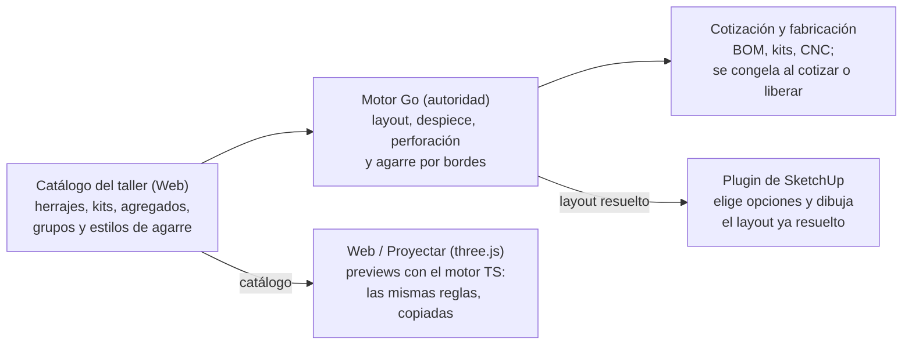

# Dossier — Herrajes, cajones, aperturas y golas

- **Tipo:** foto fechada (regla 5 de [`docs/README.md`](README.md)). No es una fuente canónica ni el estado vivo: verifica siempre contra el código y las issues.
- **Fecha:** 2026-11-11. Diagnóstico original del 2026-11-10.
- **Verificado contra:** `main` @ `55aba8db`, plugin de SketchUp `0.1.115`.
- **Origen:** revisión pedida por el owner sobre los problemas de herrajes (cajones MERIVOBOX, insertos, grupos), aperturas, posición de agregados entre la web y SketchUp, golas, puertas rebasadas y defaults del proyecto.
- **Issue:** [#1594](https://github.com/tiagofur/muebleria/issues/1594).

## Resumen ejecutivo

La mayor parte de lo reportado ya tiene modelo y código en `main`; lo que no tiene es una validación de punta a punta, y por eso se percibe roto. De las ocho quejas, casi todas tienen código mergeado que falta probar en vivo, el lado de giro de las puertas sigue sin implementar y la regla de bisagras espera decisiones del owner.

| Queja del owner | Diagnóstico | Estado al 2026-11-11 |
| --- | --- | --- |
| Elegir galería / BOXCOVER / BOXCAP sin un cajón por cada uno | Existe: grupo de accesorios vinculado al kit, más grupo de sistema de cajón y alturas automáticas | Mergeado; recorrido de validación en #1582 |
| MERIVOBOX y diseño de costados | Existe como datos + receta + assets por mano; el dibujo en SketchUp depende de assets preparados | Parcial (#1444, #1417 abiertas) |
| Posiciones distintas entre three.js y SketchUp | Espejo en X entre las dos superficies, no un problema de ±Y | Mergeado (#1575); falta verlo en vivo |
| Aperturas de puertas y cajones | Lado de giro fijo y cajón fantasma en entrepaños | Cajón fantasma mergeado (#1573); lado de giro abierto (#1574) |
| La gola no convence; falta gola central | El modelo por bordes incluye gola entre frentes | Mergeado; validación #1537 sin ejecutar; corridas y esquinas en #1584 |
| Rebase sólo en alacenas y sin milímetros | Los milímetros viven en el estilo de agarre, para cualquier tipo | Mergeado; valor propio por mueble en #1585 |
| El default del proyecto no se respeta | Biblioteca mandaba siempre la primera opción como elección explícita | Mergeado (#1577, #1581); siguen #1580 y #1587 |
| No hay regla de bisagras por altura de puerta | Existe una escalera única de 2 a 5, pero no aplica a puertas-agregado ni es por bisagra | #1579, espera decisiones del owner |

Tres causas raíz se repiten:

1. **Se cierra por issue, no por recorrido.** Cada pieza pasa sus pruebas y nadie recorre taller → proyecto → mueble → SketchUp → cotización con datos reales. La épica #1522 lo dice de su antecesora: pasó issue por issue, pero el resultado era difícil de usar.
2. **Las reglas viven en tres lugares.** Go decide, TS repite para los previews y el panel JS del plugin toma decisiones propias (qué sembrar, qué mandar como override, qué lado gira). Los fallos aparecen donde el plugin decide en vez de preguntar.
3. **Demasiados conceptos para una sola decisión del taller.** Elegir «MERIVOBOX E con galería» atraviesa agregado, variante de altura, kit, grupo de accesorio y asset por mano. Funciona, pero cualquier eslabón mal configurado falla sin un mensaje que diga cuál.

## Mapa de la app: por dónde pasa un herraje

Una sola capa decide (el motor Go) y dos capas dibujan por caminos distintos; casi todos los problemas viven en la frontera entre decidir y dibujar.

Puntos donde se rompía o aún se rompe:

- **Web:** el preview puede diferir de la cotización (#989, #1218).
- **SketchUp, geometría:** X espejado respecto a la web (#1575, mergeado).
- **SketchUp, elecciones:** Biblioteca mandaba la primera opción y pisaba el default del diseño (#1577 y #1581, mergeados).

| Capa | Dónde vive | Papel |
| --- | --- | --- |
| Catálogo | `packages/ui/src/catalogs`, `backend-go/internal/storage` | Herrajes, kits, agregados con receta, grupos de opciones, perfiles de gola, estilos de agarre |
| Motor Go | `backend-go/internal/domain/engine` | Autoridad: layout, despiece, perforaciones, agarre. Lo que cotiza y fabrica |
| Motor TS | `packages/domain` | Copia de las reglas para previews de la web; paridad probada con `contracts/fixtures` |
| Web / Proyectar | `packages/ui/src/preview3d`, `apps/web` | Dibuja con three.js; intercambia Y↔Z |
| Plugin SketchUp | `apps/sketchup-extension` | Panel HTML/JS que elige opciones + Ruby que construye el modelo desde el layout resuelto |

Una elección (tablero, herraje, sistema de cajón, inserto) se resuelve siempre en este orden: elección del mueble → default del diseño → primera opción del grupo (`backend-go/internal/domain/design_composition.go`). El agarre sigue su propio camino: estilo del proyecto → excepción por mueble, congelado al aplicar.

## Cajones: MERIVOBOX, costados, insertos y grupos

No hace falta un cajón por cada combinación: el modelo de grupos está construido en tres niveles y los tres están en `main`. Lo que falla es que son muchas piezas recién unidas, con poco recorrido en vivo.

| Qué se elige | Cómo está modelado | Estado |
| --- | --- | --- |
| Sistema de cajón (telescópica, Tandem, MERIVOBOX) | Grupo de opciones de tipo `agregado` con un rol en el mueble (`SISTEMA_CAJON`). El mueble define el hueco; el agregado define la construcción. [`interchangeable-agregados-and-option-groups.md`](architecture/interchangeable-agregados-and-option-groups.md) | Mergeado (#1482), probado en vivo |
| Altura del costado N / M / K / E | Un solo agregado con variantes de altura; el motor elige la más alta que cabe en cada bahía y cada variante trae su kit comercial | Slices 1–3 mergeados; #1493 sigue abierta |
| Inserto: galería, BOXCOVER, BOXCAP | Grupo de opciones de herraje **vinculado a un kit** (`option_groups.kit_hardware_id`, #1502). La bahía que monta ese kit dibuja y cotiza el accesorio elegido. `engine/accessory_kit.go` | Mergeado (#1504, #1523, #1563); #1555 y #1564 abiertas |
| Mano izquierda / derecha del costado | Un herraje «multi-diseño» con un asset por mano; la mano no es un SKU aparte | Mergeado (#1512, #1518) |
| Alta del sistema completo | Asistente «Nuevo sistema de cajones»: genera kits por altura, accesorios, grupos y el agregado en una transacción (~8 registros) | Mergeado (#1546, #1553) |

Regla de diseño respetada: MERIVOBOX es datos, receta, variantes y assets; el motor no tiene ningún `if merivobox` ([`merivobox-pilot.md`](architecture/merivobox-pilot.md)).

Dónde duele todavía:

- **Un grupo de accesorios pertenece a un solo kit.** Como cada altura es un kit distinto, galería / BOXCOVER / BOXCAP se declaran por altura. El asistente lo genera, pero a mano son muchos registros.
- **La elección del inserto es por mueble, no por bahía.** El mapa de elecciones va por código de grupo: dos cajones E del mismo mueble llevan el mismo inserto (#1583).
- **Elección inválida que falla en silencio.** Si la elección de sistema de cajón apunta a un agregado que ya no existe, la bahía pierde su demanda y el siguiente resolve vuelve al default sin avisar (#1564).
- **Costados y correderas en SketchUp.** Sin asset preparado, el anclaje correcto del servidor se dibuja como «restos», y los 4 miembros de una corredera comparten el SKP del par (#1444). Las partes internas del SKP con membresía fijo/móvil y acabado por parte siguen pendientes (#1417).
- **Los costados son asimétricos.** El espejo en X (#1575) mueve posiciones, no geometría de assets: el costado derecho debe verificarse en vivo.
- **Perforaciones.** Fondo MERIVOBOX M y perforación de costados del mueble por las guías fijas siguen abiertas (#1487, #1429). La matriz CNC de costados está marcada `UNKNOWN_NOT_USED` en el piloto.
- **Datos del fabricante en conflicto.** El piloto cita espacio mínimo M = 107 mm y #1493 cita 108.0. El archivo `docs/dossier-merivobox.md` que citan #1487 y #1493 no existe en el repositorio (#1586).
- **La web no muestra lo mismo que la cotización.** El preview vivo aún no consume la demanda de herrajes por perfil (#989).

## Aperturas: puertas y frentes de cajón

Las aperturas fallaban por tres defectos concretos en el mismo grupo de archivos del plugin, no por el modelo. Desde la enmienda 1 de ADR-0009, «Apertura» significa sólo giro y animación; el agarre (gola, jaladera, rebase) es otro concepto.

| Síntoma | Causa | Issue |
| --- | --- | --- |
| Puertas izquierda y derecha intercambiadas en SketchUp | Las dos superficies dibujaban imágenes espejadas en X | #1575, mergeado |
| La puerta única abre por el lado sin bisagras | El lado de giro es `left` fijo en tres capas (`resolver.rb`, `granete-inspector.js`, `inspector_bridge.rb`); nunca se lee de dónde están las bisagras | #1574, abierta |
| Aparecía un «Cajón 1» inexistente y el entrepaño se deslizaba | `layout.go` sella `assemblyInstanceId` en los tableros de cualquier agregado y `door_actors.rb` trataba todo tablero con ese id como caja de cajón | #1573, mergeado |
| Las recetas de puerta de alacena no están espejadas | `AGR-PUE-DER-ALA` y `AGR-PUE-IZQ-ALA` tienen las bisagras en el mismo borde (`xMm: 20.5`) | Dato de catálogo, anotado en #1574 |

Más allá de esos:

- **La cantidad de bisagras del preview web puede diferir de la cotización.** El servidor respeta la política de bandas de la fábrica; los previews del cliente usan la escalera de librería (#1218).
- **Herraje distinto por copia** (izquierda/derecha en piezas repetidas) no existe: las copias clonan la misma colocación (#1452).
- **Cinemática de cajón, abatible y elevable** está diferida como P3 (#1377).

## Cantidad de bisagras por altura de puerta

La regla existe en el motor, pero no llega a las puertas del catálogo del taller ni es una regla por bisagra. Entró con #1078 como una escalera única de librería.

| Alto de puerta hasta | Bisagras |
| --- | --- |
| 900 mm | 2 |
| 1600 mm | 3 |
| 2000 mm | 4 |
| 2400 mm | 5 |

Además suma una bisagra si la puerta mide más de 650 mm de ancho. Fuente: `packages/domain/src/hingeDemand.ts`, con paridad en Go por `contracts/hingeDemandBands.contract.json`.

Lo que falta frente a lo pedido:

- **No aplica a puertas que son agregados.** Las puertas `AGR-PUE-*` traen las bisagras colocadas a mano en la receta; los agregados no derivan la banda (ítem 2 de #1218). Una puerta de 2100 mm lleva las mismas bisagras que una de 720.
- **No es por bisagra.** Hay una sola escalera para todo el taller, con un override por política de fábrica y otro por componente. El herraje no declara su propia tabla. «Bandas por marca» quedó fuera de alcance en #1218.
- **No usa el peso.** El manual del fabricante da la cantidad por alto y peso; el peso como entrada se excluyó en #1078.
- **Sin pantalla de edición.** No hay referencias a la política en `packages/ui` ni en `apps/web`.
- **Las posiciones de las cazoletas** se generan sólo en TS; Go no las deriva (ítem 3 de #1218).

Propuesta en #1579: la tabla de bandas (alto → cantidad, de 2 a 5, más la regla de ancho) se declara en el herraje o en su grupo, con los valores del fabricante como sugerencia editable. Orden de resolución: excepción del componente → tabla de la bisagra elegida → política de fábrica → escalera de librería. Las puertas-agregado pasan a derivar cantidad y posiciones de esa misma regla.

## Posición de agregados: web (three.js) contra SketchUp

El problema no era «+Y contra −Y»: las dos superficies dibujaban el mismo dato como imágenes **espejadas en X**, y ninguna rotación lo arregla.

| Superficie | Qué hace con las coordenadas del motor | Dónde quedaba x = 0 visto de frente |
| --- | --- | --- |
| Web / Proyectar | Intercambia Y↔Z: taller (x, y, z) → three (x, z, y). Ese intercambio es una reflexión (determinante −1). `packages/ui/src/preview3d/boardPartVisual.ts` | Izquierda |
| SketchUp (antes de #1575) | Usaba la posición del motor tal cual, con el frente en +Y (#414) | Derecha |

- Un gabinete con «Puerta Izquierda» en x = 0 y «Puerta Derecha» en `PW/2` se veía bien en la web y con las puertas intercambiadas en SketchUp.
- El eje de profundidad no era el problema: el frente va en +Y y el cajón sale hacia +Y.

**Decisión del owner (opción A), implementada en #1575:** la web es la referencia. El builder de SketchUp refleja el layout resuelto en X con números ya calculados y sin instancias espejadas. El motor Go y el mapa de la web no cambian. Cambiar la convención global (frente en −Y) quedó descartado porque rompe releases publicados y fixtures de CNC.

**Riesgo a vigilar:** los assets SKP asimétricos (costado izquierdo y derecho de MERIVOBOX, rieles con mano) no se espejan con el pase de posición. Verificar en vivo que cada mano cae en su lado.

## Golas y la gola central de cajoneros

La gola central existe en el motor y en el plugin desde la épica #1522, pero nadie la ha validado de punta a punta.

| Pieza | Estado en `main` | Evidencia |
| --- | --- | --- |
| Motor por bordes: descuento arriba, entre frentes y rebase | Mergeado (#1529) | `engine/opening_a3_pass.go`, `opening_edge_stack.go` |
| Gola entre frentes: descuento, muesca en costados, perfil en BOM por cada borde | Mergeado (#1529) | `opening_notch_layout.go`, `opening_project_grip.go` (`BetweenEdgeCount`) |
| Estilos de agarre del taller por tipo de mueble | Mergeado (#1531, #1533) | Web › Ajustes › Agarres |
| Agarre del proyecto con excepción por mueble, congelado | Mergeado (#1532, #1535) | `granete-grip.js`, `project_grip_bridge.rb` |
| Dibujo en SketchUp: perfil L/C, tira italiana, bisel | Mergeado (#1536) | plugin ≥ 0.1.112 |
| Perfil de gola v2: retiro de campos viejos y migración | Abierto (#1530); sólo entró la parte aditiva | |
| Validación de seis casos en navegador y SketchUp real | Abierto (#1537), sin ejecutar | |

Para tener gola central en un cajonero: en Ajustes › Agarres, el estilo debe tener, para el tipo `inferior`, modo gola con perfil superior **y** perfil «entre frentes». La posición no se elige: el motor cuenta las filas de frentes del mueble y pone un perfil en cada borde intermedio. Un mueble de puertas con ese mismo estilo no recibe perfil central.

Reservas que siguen en pie:

- **No está probado en vivo.** El caso 2 de #1537 (cajonera de 3 frentes, L arriba + C entre cada frente, ≈ 202.7 mm por frente) es exactamente el caso del owner.
- **La gola es por mueble, no por corrida.** En una cocina real el perfil corre continuo sobre varios muebles y dobla en esquinas. Hoy la BOM corta un tramo por mueble y no hay piezas de esquina (#1584).
- **Sólo hay tres tipos de mueble** (`inferior`, `superior`, `alto`). No existe «cajonero» como tipo: gola C sólo en cajoneros se resuelve con una excepción por mueble.
- **Queda un resto del modelo viejo en el motor.** El plugin retiró la tarjeta antigua con #1535, pero el motor aún emite `OPENING_STACKED_FRONTS_UNSUPPORTED` para diseños migrados que tenían gola inferior: hay que volver a aplicar el agarre en esos muebles.

## Puertas rebasadas

Los milímetros del rebase son un parámetro del estilo de agarre, 20 mm por defecto y editable (ADR-0009 enmienda 1, A4).

- **Antes:** el rebase se podía activar, pero ninguna pantalla escribía `opening.bottom-overhang`. Toda selección terminaba en `OPENING_OVERHANG_EVIDENCE_PENDING`.
- **Ahora:** el estilo declara `bottom_overhang` con sus milímetros por tipo de mueble (`backend-go/internal/domain/grip_style.go`). El motor baja el borde inferior del frente más bajo esos milímetros (`opening_project_grip.go`).
- **No está limitado a alacenas:** el modelo acepta rebase en `inferior`, `superior` y `alto`.
- **Excepción por mueble:** hoy sólo admite otro estilo. Un rebase distinto en un solo mueble exige crear un segundo estilo (#1585).

Pendiente de comprobar en vivo: caso 3 de #1537 (alacena de 1 puerta, rebase 20 → frente de 597 × 738.5).

## Defaults de herrajes del proyecto

El default del diseño no se respetaba porque el panel de Biblioteca de SketchUp mandaba siempre la **primera opción del grupo** como elección explícita del mueble, y una elección explícita le gana al default. El servidor tenía la regla correcta.

Causa en `apps/sketchup-extension/.../resources/js/granete-configurator.js`, tal como estaba:

1. `defaultMaterialChoices(def)` armaba las elecciones consultando los defaults del diseño.
2. `seedLibraryHardwareChoices` escribía `role.optionIds[0]` en cada grupo de herrajes.
3. `seedLibraryAgregadoChoices` hacía lo mismo con los grupos de agregado y pisaba el paso 1.
4. Al insertar, esas elecciones viajaban siempre como `materialOverrides`.

Qué se arregló:

- **#1577 (PR #1578):** la siembra sigue la regla del servidor y un grupo sólo viaja como override cuando el usuario lo eligió.
- **#1581 (PR #1588):** Biblioteca pide una lectura fresca de los defaults al abrir, Insertar espera a que llegue (tope de 2 s) y se re-siembra sólo lo no tocado.

Qué queda:

- **#1580:** la tarjeta «Herrajes del diseño» sólo lista grupos de tipo `hardware`; el sistema de cajón y los insertos no se pueden fijar como default del diseño desde SketchUp.
- **#1587:** los muebles insertados antes de #1577 conservan su override; falta una restauración en lote.
- **Verificación en vivo** de #1577 y #1581 en SketchUp real.

## Plan de ataque recomendado

Primero probar lo que ya está mergeado, después cerrar la geometría del plugin, y no abrir modelo nuevo hasta que un recorrido completo pase.

1. **Poner el entorno al día.** `main` actualizado, RBZ vigente instalado y migraciones 000181 y 000182 aplicadas. Sin esto cualquier prueba mide el modelo viejo.
2. **Verificar en vivo los arreglos del plugin ya mergeados:** defaults (#1577, #1581), espejo en X (#1575) y cajón fantasma (#1573).
3. **Lado de giro por bisagras** (#1574), incluido el arreglo de datos de `AGR-PUE-*-ALA`.
4. **Recorrido de agarres** (#1537): seis casos en navegador y SketchUp real. Empezar por el caso 2 (cajonera con gola central) y el 3 (rebase 20 mm).
5. **Recorrido MERIVOBOX** (#1582): cajonero de 3 cajones M/M/E con galería, registrado con el asistente de sistema, insertado, cotizado y cambiado a BOXCOVER y a Tandem sin tocar el catálogo. Cada fallo se convierte en issue.
6. **Cerrar lo que los recorridos destapen** antes de sumar alcance: #1564, #1444, #1530, #1493, #1586, #1580, #1587.
7. **Después**, decisiones de producto a la espera del owner: bisagras por altura declaradas por herraje (#1579), inserto por bahía (#1583), gola por corrida y esquinas (#1584) y rebase con milímetros propios por mueble (#1585).

## Issues abiertas a partir de este dossier

Las que dicen «espera decisión» no llevan `status:approved`: no se puede publicar contra ellas hasta que el owner las apruebe.

| Issue | Qué resuelve | Estado al 2026-11-11 |
| --- | --- | --- |
| [#1577](https://github.com/tiagofur/muebleria/issues/1577) | Biblioteca hereda el default del diseño en herrajes y agregados | PR #1578 mergeado; falta prueba en vivo |
| [#1581](https://github.com/tiagofur/muebleria/issues/1581) | Biblioteca siembra con defaults desactualizados | PR #1588 mergeado; falta prueba en vivo |
| [#1580](https://github.com/tiagofur/muebleria/issues/1580) | Fijar sistema de cajón e insertos como default del diseño desde SketchUp | Aprobada |
| [#1582](https://github.com/tiagofur/muebleria/issues/1582) | Recorrido MERIVOBOX de punta a punta, seis casos | Aprobada; falta decidir assets reales o sintéticos |
| [#1587](https://github.com/tiagofur/muebleria/issues/1587) | Restaurar en lote los muebles que quedaron «Personalizados» | Aprobada |
| [#1586](https://github.com/tiagofur/muebleria/issues/1586) | Dossier MERIVOBOX ausente y cifra 107 contra 108.0 | Aprobada |
| [#1579](https://github.com/tiagofur/muebleria/issues/1579) | Cantidad de bisagras por altura declarada por herraje | Espera decisión (4 preguntas) |
| [#1583](https://github.com/tiagofur/muebleria/issues/1583) | Inserto de cajón distinto por bahía | Espera decisión (3 preguntas) |
| [#1584](https://github.com/tiagofur/muebleria/issues/1584) | Gola por corrida multi-mueble y esquinas | Espera decisión (fase 0) |
| [#1585](https://github.com/tiagofur/muebleria/issues/1585) | Rebase con milímetros propios por mueble | Espera decisión (1 pregunta) |

Ya tenían issue antes del dossier y seguían abiertas a la fecha: #1574 (lado de giro), #1537 y #1530 (agarres), #1493, #1487, #1444, #1417, #1429, #1555, #1564 (cajones), #1218, #1452 (bisagras) y #989 (preview web).
